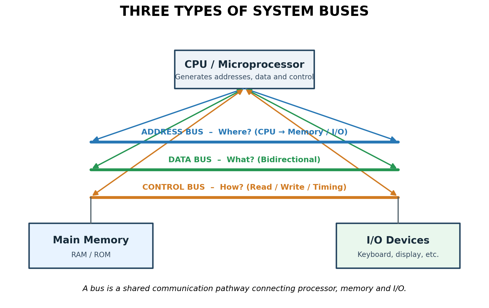
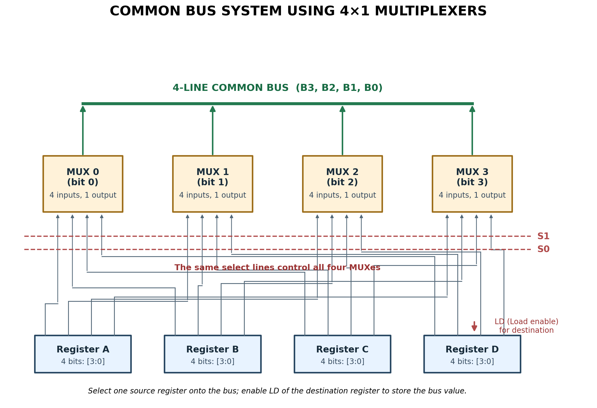

# Computer Organization and Architecture (COA)

These notes follow the two classroom-board diagrams supplied: (1) types of system buses and (2) a 4-register common bus built using four 4×1 multiplexers.

---

# Chapter 1 – Types of Buses

## 1. What is a bus?
A **bus** is a group of communication lines (wires) used to transfer information between the CPU, main memory and input/output (I/O) devices.

The three main system buses are:
- **Address bus:** tells *where* to access.
- **Data bus:** carries *what* is being transferred.
- **Control bus:** tells *how/when* the operation happens.




## 2. Address bus
**Definition:** Carries the address of the memory location or I/O port that the processor wants to access.

- Normally unidirectional: CPU → memory/I/O.
- Number of address lines determines the number of distinct addresses.
- Formula: **Number of addressable locations = 2ⁿ**, where `n` is the number of address bits.

| Address width | Addressable locations |
|---:|---:|
| 8 bits | 2⁸ = 256 |
| 10 bits | 2¹⁰ = 1,024 |
| 16 bits | 2¹⁶ = 65,536 = 64K |
| 20 bits | 2²⁰ = 1,048,576 = 1M |
| 32 bits | 2³² |

If each address identifies one byte, a 16-bit address bus can address **64 KiB** of byte-addressable memory. (The address width alone does not say how many bytes each location contains; that depends on the system.)

## 3. Data bus
**Definition:** Carries the actual data or instruction bytes between CPU, memory and I/O.

- Usually bidirectional for a read/write memory interface.
- An 8-bit data bus transfers 8 bits (1 byte) per bus data transfer.
- A 16-bit data bus transfers 16 bits (2 bytes) per bus data transfer.
- Data-bus width and address-bus width are different properties.

## 4. Control bus
**Definition:** Carries command, status and timing signals that coordinate a bus operation.

Common examples:
- **RD̅ / Read:** requests a read operation.
- **WR̅ / Write:** requests a write operation.
- **IO/M:** distinguishes I/O and memory operations in the 8085.
- **ALE:** Address Latch Enable; helps latch the lower address from multiplexed AD7–AD0.
- **READY:** allows wait states when a device is not ready.
- **RESET IN:** resets the processor.
- **CLK:** clock/timing reference.

A bar over a signal name (for example, RD̅) means it is **active-low**: the asserted state is logic 0.

### Memory read vs memory write
**Read:** CPU places an address on the address bus → asserts read control → memory places data on the data bus → CPU receives it.

**Write:** CPU places an address and data on their buses → asserts write control → memory stores the data at that address.

## 5. 8085 microprocessor – bus facts
The Intel **8085 is an 8-bit microprocessor**:
- Data bus: 8 bits, `D7–D0` (the lower pins are multiplexed as `AD7–AD0`).
- Address bus: 16 bits, `A15–A0`.
- Maximum address space: `2¹⁶ = 65,536` byte locations = **64 KiB**, assuming byte addressing.
- `A15–A8` carry the higher address bits.
- `AD7–AD0` carry the lower address during the address phase, then data during the data phase.
- **ALE** indicates the address phase so an external latch can hold the lower address.

**Do not mix these up:** 8-bit data bus ≠ 8-bit address bus. The 8085 has an 8-bit data bus and a 16-bit address bus.

## 6. What does “8-bit” mean? Carry example
An 8-bit unsigned register can represent values from `0` to `2⁸−1 = 255`.

Example:
```text
  11111111   (255)
+ 00000001   (1)
-----------
1 00000000   (256)
^
9th-bit carry out
```
The 8-bit result retained in the register is `00000000`; the extra carry is represented by the carry flag (CY) in the processor status flags. A carry is not an extra address line.

---

# Chapter 2 – Common Bus System Using Multiplexers

## 1. What is a common bus system?
A **common bus system** is a shared set of lines that allows one selected register to transfer its contents to another register or a destination.

Instead of connecting every register directly to every other register, registers share a bus. This reduces wiring complexity.

The supplied board diagram has:
- Four 4-bit registers: **A, B, C, D**.
- Four **4×1 multiplexers**: one MUX for each bus bit.
- Two common select lines: **S1 and S0**.
- A 4-line common bus: **B3, B2, B1, B0** (the board labels the four output lines).
- A load-enable input (**LD**) on the destination register.



## 2. Why are four 4×1 MUXes required?
Each register contains 4 bits:
- A = A3 A2 A1 A0
- B = B3 B2 B1 B0
- C = C3 C2 C1 C0
- D = D3 D2 D1 D0

The common bus must carry 4 bits in parallel. For each bit position, it must choose one of the four corresponding register bits.

| MUX | Inputs (one bit from each register) | Output |
|---|---|---|
| MUX 0 | A0, B0, C0, D0 | Bus bit 0 |
| MUX 1 | A1, B1, C1, D1 | Bus bit 1 |
| MUX 2 | A2, B2, C2, D2 | Bus bit 2 |
| MUX 3 | A3, B3, C3, D3 | Bus bit 3 |

Therefore:
- Number of MUXes = number of bits in each register = **4**.
- Each MUX has 4 inputs because there are **4 source registers**.
- The common bus width is **4 bits**.

**General formula for this arrangement:**
- Number of MUXes = `n` (register width in bits).
- MUX size = `m:1`, where `m` is the number of source registers.
- Select lines required = `ceil(log₂ m)`.

For `m = 4`, select lines = `log₂4 = 2`.

## 3. Selection table – S1 and S0
The two select lines choose which register is connected to the common bus.

| S1 | S0 | Selected source | Bus receives |
|:--:|:--:|---|---|
| 0 | 0 | A | A3 A2 A1 A0 |
| 0 | 1 | B | B3 B2 B1 B0 |
| 1 | 0 | C | C3 C2 C1 C0 |
| 1 | 1 | D | D3 D2 D1 D0 |

This is the mapping shown in the classroom diagram. The select code is binary:
- `00` = 0 = A
- `01` = 1 = B
- `10` = 2 = C
- `11` = 3 = D

## 4. How does data transfer happen?
Example: `A ← C`

Meaning: Copy the contents of register C into register A.

Step-by-step:
1. Set `S1 S0 = 10` to select register C.
2. All four MUXes select C's corresponding bit.
3. The common bus now carries `C3 C2 C1 C0`.
4. Enable the load input of register A: `LD_A = 1`.
5. At the active clock edge, A stores the bus value.

Example values:
```text
Before:
A = 0000
C = 1011

Select C: S1 S0 = 10
Common bus = 1011
LD_A = 1

After the active clock edge:
A = 1011
C = 1011  (unchanged)
```
The source register is not erased. This is a copy operation.

## 5. Load (LD) signal – important
A load signal controls whether a register accepts the value currently present on its input.

For a typical positive-edge-triggered register:
- `LD = 0`: hold the old value.
- `LD = 1`: load the input value at the active clock edge.

For example:
```text
LD_A = 1  → Register A loads bus data at the clock edge
LD_A = 0  → Register A keeps its previous contents
```

**Important distinction:** S1 and S0 select the **source** register. LD selects/enables the **destination** register. They do different jobs.

### Example control sequence: B ← D
- Select D: `S1 S0 = 11`.
- Common bus carries D3 D2 D1 D0.
- Set `LD_B = 1`.
- On the active clock edge, B receives D's value.

---

# Chapter 3 – Binary Selection, 2ⁿ and Register Selection

## 1. Why do we use 2ⁿ?
Each binary selection line has two possible values: 0 or 1.

| Number of select lines | Possible combinations | Number of choices |
|---:|---|---:|
| 1 | 0, 1 | 2 = 2¹ |
| 2 | 00, 01, 10, 11 | 4 = 2² |
| 3 | 000 through 111 | 8 = 2³ |
| 4 | 0000 through 1111 | 16 = 2⁴ |

Formula: **Number of choices = 2ⁿ**.

## 2. Your 3-bit example: 8 possible selections
For three select bits `S2 S1 S0`:

| Decimal | S2 | S1 | S0 |
|---:|:---:|:---:|:---:|
| 0 | 0 | 0 | 0 |
| 1 | 0 | 0 | 1 |
| 2 | 0 | 1 | 0 |
| 3 | 0 | 1 | 1 |
| 4 | 1 | 0 | 0 |
| 5 | 1 | 0 | 1 |
| 6 | 1 | 1 | 0 |
| 7 | 1 | 1 | 1 |

So `2³ = 8`: three selection bits can select one of eight input choices (for example, an 8×1 MUX).

There are **8 possible choices, numbered 0 to 7**. Do not confuse this with seven choices.

## 3. 4×1 vs 8×1 MUX
| Feature | 4×1 MUX | 8×1 MUX |
|---|---:|---:|
| Data inputs | 4 | 8 |
| Select lines | 2 | 3 |
| Output | 1 | 1 |
| Select combinations | 4 | 8 |

A 4×1 MUX needs two select lines; an 8×1 MUX needs three.

## 4. Register names you may see
Examples of CPU registers:
- **PC – Program Counter:** holds the address of the next instruction.
- **IR – Instruction Register:** holds the current instruction.
- **AC – Accumulator:** holds arithmetic/logic operands or results in architectures that use it.
- **DR – Data Register:** holds data being transferred.
- **TR – Temporary Register:** temporary storage during processing.

The exact register set depends on the processor/architecture. These names are examples; they do not mean that the four-register A/B/C/D diagram contains all these registers.

---

# Chapter 4 – Gate Exam Important Points

1. Address bus width determines the number of addressable locations: `2ⁿ`.
2. Data bus width determines the number of bits transferred in one bus data transfer.
3. Address bus is generally unidirectional; data bus is bidirectional.
4. Control bus carries read, write and timing/control signals.
5. 8085 has a 16-bit address bus and an 8-bit data bus.
6. 8085 can address 64 KiB of byte-addressable memory.
7. `2` select lines select up to `4` choices.
8. `3` select lines select up to `8` choices.
9. A 4-bit common bus needs four parallel 1-bit MUX outputs.
10. Four source registers require four 4×1 MUXes in this design.
11. Select lines choose the source; the destination's LD signal enables loading.
12. A register normally captures data at its specified active clock edge.
13. A 4×1 MUX has 4 inputs, 1 output and 2 select lines.
14. An 8×1 MUX has 8 inputs, 1 output and 3 select lines.

## GATE-style practice questions

**Q1.** A processor has 16 address lines. How many distinct addresses can it generate?

Answer: `2¹⁶ = 65,536`.

**Q2.** How much byte-addressable memory can a 16-bit address bus address?

Answer: `65,536 bytes = 64 KiB`.

**Q3.** How many select lines are required for an 8×1 MUX?

Answer: `log₂8 = 3`.

**Q4.** Four 8-bit registers are connected to a common bus using MUXes. How many 4×1 MUXes are required?

Answer: 8 MUXes, one for each bit position.

**Q5.** In the 4-register common bus, what is selected when S1S0 = 10?

Answer: Register C.

**Q6.** What is the role of LD_A?

Answer: It enables register A to load the value on the bus at its active clock edge.

**Q7.** Is the 8085 an 8-bit or 16-bit microprocessor?

Answer: 8-bit microprocessor. Its address bus is 16-bit.

**Q8.** What is the maximum unsigned value represented by 8 bits?

Answer: `2⁸ − 1 = 255`.

---

# One-Minute Revision Sheet

| Topic | Remember |
|---|---|
| Address bus | Where? |
| Data bus | What? |
| Control bus | How? |
| Address locations | 2ⁿ |
| 16-bit address | 64 KiB if byte-addressed |
| 8085 data bus | 8-bit |
| 8085 address bus | 16-bit |
| 4×1 MUX | 4 inputs, 2 select lines |
| 8×1 MUX | 8 inputs, 3 select lines |
| Four 4-bit registers | Four 4×1 MUXes |
| S1S0 = 00 | A |
| S1S0 = 01 | B |
| S1S0 = 10 | C |
| S1S0 = 11 | D |
| LD = 1 | Load at active clock edge |
| LD = 0 | Hold previous value |

## Quick memory mnemonic

**A-D-C = Address, Data, Control**
- Address → Location
- Data → Information
- Control → Instruction/command for the operation

**MUX = Select one input, pass it to one output.**

**LD = Load the selected bus value into the destination register.**

---

## Suggested revision order

1. First learn the three types of buses.
2. Memorize 8085's 8-bit data bus and 16-bit address bus.
3. Practise `2ⁿ` and binary counting.
4. Understand why four 4×1 MUXes make a 4-bit common bus.
5. Practise register transfers such as `A ← C` and `B ← D`.
