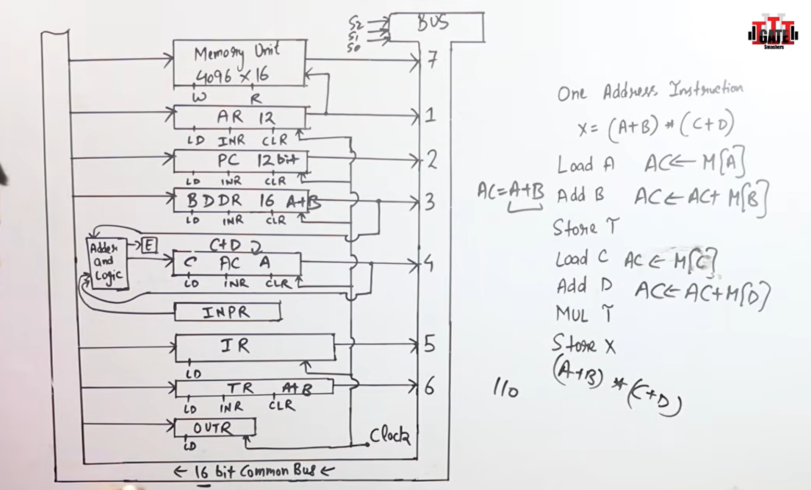
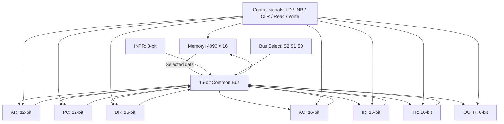

# Common Bus System 

## 1. What is a Common Bus System?

A **common bus system** is a shared set of communication lines used to transfer binary data between CPU registers, memory, and other components. Rather than requiring a separate connection between every pair of registers, the CPU uses one shared bus.

### Why do we need a common bus?
- Reduces the number of wires and hardware connections.
- Makes register-to-register data transfers easier to organize.
- Allows one selected source to place data on the bus and a destination register to load it.
- Control signals determine which source is selected and which destination is loaded.

> At a time, the bus is normally driven by **one selected source**. Multiple destinations may load the same bus value if their load controls are enabled.

## 2. Common Bus Architecture (Diagram)

**Concept:** Bus selection decides *which source* puts data onto the bus. The destination's load (`LD`) control decides *which register receives* that data.

> The diagram is a conceptual view of a shared bus. The exact source-to-selector code depends on the implementation/table provided in a question.

## 3. Important Registers and Their Functions

| Register / Unit | Full form / role | Size in this diagram | Function |
|---|---|---:|---|
| **AR** | Address Register | 12 bits | Holds the memory address for a memory operation. |
| **PC** | Program Counter | 12 bits | Holds the address of the next instruction to fetch (or current fetch address). |
| **DR** | Data Register | 16 bits | Holds data read from memory or data being used in an operation. |
| **AC** | Accumulator | 16 bits | Stores operands and arithmetic/logic results. |
| **IR** | Instruction Register | 16 bits | Holds the instruction currently being decoded/executed. |
| **TR** | Temporary Register | 16 bits | Holds temporary data during CPU operations. |
| **INPR** | Input Register | 8 bits | Holds data received from an input device. |
| **OUTR** | Output Register | 8 bits | Holds data to be sent to an output device. |
| **Memory** | Main memory | 4096 words × 16 bits | Stores instructions and data. |
| **Common Bus** | Shared data path | 16 bits | Transfers data between components. |

## 4. Register Control Signals

| Signal | Meaning | Typical action |
|---|---|---|
| `LD` | Load | Load the register from the bus (or specified source). |
| `INR` | Increment | Increase the register by 1. |
| `CLR` | Clear | Set the register to zero. |
| `Read` | Memory read | Transfer the selected memory word to the CPU data path. |
| `Write` | Memory write | Store bus data into the selected memory word. |

## 5. Memory: 4096 × 16

The memory specification **4096 × 16** means:

- **4096 words** (memory locations)
- **16 bits per word**

Since 4096 = 2¹², the memory needs **12 address bits** to select one word.

### Memory calculations

- Number of locations = 4096 = 2¹²
- Address bits = log₂(4096) = **12 bits**
- Word size = **16 bits**
- Total capacity = 4096 × 16 = **65,536 bits**
- Capacity in bytes = 65,536 ÷ 8 = **8,192 bytes = 8 KiB**

**Address range:** `0` to `4095` (decimal), or `000000000000` to `111111111111` (12-bit binary).

### GATE numerical shortcut

For a memory containing **N words**, each of **W bits**:

- Address bits = `log₂(N)` (when N is a power of 2)
- Total memory size = `N × W` bits
- Byte capacity = `(N × W) / 8`

**Example:** 8192 words × 32 bits  
Address bits = log₂(8192) = 13 bits  
Capacity = 8192 × 32 = 262,144 bits = 32 KiB.

## 6. Bus Selection: S₂, S₁, S₀

The selection lines determine which source is connected to the bus. If there are **8 possible sources**, the number of selection bits required is:

`2³ = 8` → **3 select lines** (`S₂`, `S₁`, `S₀`).

| Select bits | Decimal selection |
|---|---:|
| `000` | 0 |
| `001` | 1 |
| `010` | 2 |
| `011` | 3 |
| `100` | 4 |
| `101` | 5 |
| `110` | 6 |
| `111` | 7 |

> Do not assume which register corresponds to each binary code unless the question gives the bus-source mapping table.

### GATE formula

For `n` bus sources, the minimum number of select lines is:

`k = ⌈log₂(n)⌉`

Examples:
- 4 sources → 2 select lines
- 8 sources → 3 select lines
- 16 sources → 4 select lines

## 7. Register Transfer Notation (RTN)

Register transfer notation expresses an operation performed by the CPU.

| Notation | Meaning |
|---|---|
| `AR ← PC` | Copy the contents of PC into AR. |
| `PC ← PC + 1` | Increment PC. |
| `DR ← M[AR]` | Read memory at address AR into DR. |
| `M[AR] ← DR` | Write DR into the memory location addressed by AR. |
| `AC ← AC + DR` | Add DR to AC and store the result in AC. |
| `AC ← 0` | Clear AC. |

### Understand the notation

- `←` means **gets / is loaded with**.
- `M[AR]` means **the memory word stored at the address currently held in AR**.
- `M[A]` means **the memory word stored at memory address A**; A here is an address/symbol, not necessarily the value of a CPU register named A.

## 8. Example: Data Transfer Using the Common Bus

### Transfer PC to AR

`AR ← PC`

Steps:
1. Select PC as the bus source.
2. PC places its value on the common bus.
3. Enable `LD` for AR.
4. AR loads the value from the bus.

### Increment PC

`PC ← PC + 1`

Enable the increment (`INR`) operation for PC.

### Read memory into DR

`DR ← M[AR]`

1. AR contains the address to read.
2. Activate the memory read operation.
3. The selected memory word is transferred into DR (according to the CPU's datapath/control design).

## 9. One-Address Instruction Example (GATE-style)

Evaluate and store:

`X = (A + B) × (C + D)`

Assume a one-address instruction set with an accumulator (AC), and that the instruction set includes `LOAD`, `ADD`, `STORE`, and `MUL`. Here `A`, `B`, `C`, `D`, `T`, and `X` represent memory locations.

| Step | Instruction | Effect on AC / Memory |
|---:|---|---|
| 1 | `LOAD A` | `AC ← M[A]` |
| 2 | `ADD B` | `AC ← AC + M[B]` = A + B |
| 3 | `STORE T` | `M[T] ← AC` (save A + B) |
| 4 | `LOAD C` | `AC ← M[C]` |
| 5 | `ADD D` | `AC ← AC + M[D]` = C + D |
| 6 | `MUL T` | `AC ← AC × M[T]` = (C + D) × (A + B) |
| 7 | `STORE X` | `M[X] ← AC` |

**Final result:** `M[X] = (M[A] + M[B]) × (M[C] + M[D])`

**Note:** `MUL T` is used here as an assumed instruction. If a particular processor or exam question does not provide a multiplication instruction, multiplication must be implemented using that instruction set's available operations.

## 10. GATE Numerical Practice

### Numerical 1 — Address bits

A memory contains 2048 words. How many address bits are required?

`2048 = 2¹¹`  
**Answer: 11 address bits.**

### Numerical 2 — Memory capacity

A memory has 1024 words, with 32 bits in each word. Find its total capacity in bytes.

`1024 × 32 = 32,768 bits`  
`32,768 ÷ 8 = 4,096 bytes = 4 KiB`  
**Answer: 4 KiB.**

### Numerical 3 — Number of bus select lines

A common bus selects among 12 sources. What is the minimum number of select lines?

`k = ⌈log₂(12)⌉ = 4`  
4 select bits provide 16 combinations, enough for 12 sources.  
**Answer: 4 select lines.**

### Numerical 4 — Bus width

A CPU has 16-bit registers and a 16-bit common bus. How many bits can be transferred in one bus transfer?

**Answer: 16 bits** (the bus carries one 16-bit word per transfer).

### Numerical 5 — Memory address range

For 4096 memory locations, find the first and last address in hexadecimal.

- First address: `0x000`
- Last address: `4095 = 0xFFF`
- Address width: 12 bits

**Answer: `0x000` through `0xFFF`.**

## 11. Quick Revision — GATE / COA

- **Common bus:** shared data path between registers, memory, and CPU components.
- **Bus source selection:** select lines choose the source that drives the bus.
- **Load (`LD`):** destination register captures the bus value.
- **AR:** holds memory address; 12 bits for 4096 locations.
- **PC:** holds instruction address; 12 bits in this diagram.
- **DR:** data register, 16 bits.
- **AC:** accumulator for arithmetic and logic operations.
- **IR:** holds the instruction being processed.
- **TR:** temporary storage register.
- **INPR / OUTR:** input and output registers, commonly 8 bits in this datapath.
- **Memory `4096 × 16`:** 4096 words, 16 bits/word, 12 address bits, 8 KiB capacity.
- **3 select lines:** can select up to 8 sources (`2³`).
- **RTN:** `Destination ← Source` describes a register transfer or operation.
- **`M[AR]`:** memory contents at the address held in AR.

## 12. Practice Questions (Try Yourself)

1. A memory has 16,384 locations. How many address bits are required?
2. A memory is 2048 × 8. Find its capacity in bytes and KiB.
3. How many select lines are needed to choose from 32 bus sources?
4. If AR = 125 and `DR ← M[AR]`, what memory location is read?
5. If `AC = 12` and `DR = 7`, what is the result of `AC ← AC + DR`?

### Answers

1. `log₂(16,384) = 14` address bits.
2. `2048 × 8 = 16,384 bits = 2048 bytes = 2 KiB`.
3. `log₂(32) = 5` select lines.
4. Memory location `125`.
5. `12 + 7 = 19`, so AC becomes `19`.

---

**COA topic:** Register organization, common bus, memory organization, register transfer language (RTL/RTN), and accumulator-based instruction execution.
